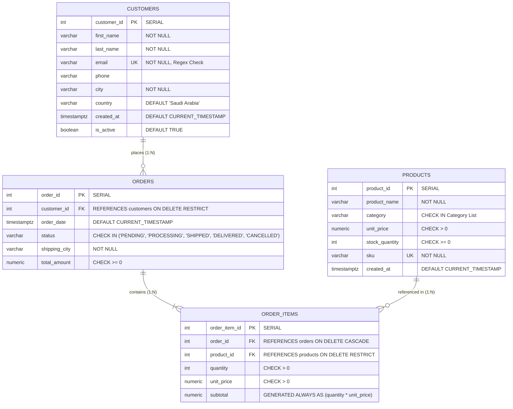

# AI-Assisted PostgreSQL Database Project Report
**Course / Track**: AI-Assisted Database Engineering  
**Session**: Session 4 - Assignment  
**Project Title**: E-Commerce Store & Order Management Database System  
**Submission Form**: [Google Form Submission Link](https://forms.gle/SS45sZLZFMsg37z68)  
**Database Engine**: PostgreSQL 14+ / 16  
**Language**: SQL (DDL, DML, DQL, TCL)  

---

## Executive Summary (ملخص تنفيذي للمشروع)
تم بناء هذا المشروع وتصميمه بالكامل باستخدام تقنيات الذكاء الاصطناعي (AI) وفقاً لجميع متطلبات التكليف (Session 4 - Assignment):
1. اختيار فكرة مشروع واقعية وتصميم **4 جداول مترابطة علاقاتياً** (E-Commerce Store & Order Management).
2. تحديد المفاتيح الأساسية (Primary Keys)، المفاتيح الأجنبية (Foreign Keys)، والقيود المتقدمة (CHECK, UNIQUE, NOT NULL, DEFAULT, GENERATED ALWAYS).
3. توليد وتجهيز مخطط قاعدة البيانات (DDL Schema) مع بيانات تجريبية واقعية وتوليد آلي لأكثر من 5,000 سجل للاختبار.
4. كتابة وتنفيذ استعلامات **CRUD** كاملة، استعلامات **JOIN** متعددة الجداول، استعلامات التجميع **GROUP BY** مع **HAVING**، واستعلامات تقسيم الصفحات (**Pagination**).
5. توثيق وتطبيق المعاملات المالية المترابطة (Transactions) باستخدام **COMMIT** عند النجاح و **ROLLBACK** عند حدوث أخطاء.
6. تقييم أداء الفهارس (Indexes) ومقارنتها باستخدام **EXPLAIN ANALYZE** وتوثيق استخدام الذكاء الاصطناعي بالتفصيل.

---

## 1. Project Idea & Entity Relationship Diagram (ERD)

### فكرة المشروع:
نظام إدارة متجر إلكتروني ومشتريات رياضي (`FitGear Store`)، يتتبع بيانات العملاء، كتالوج المنتجات والمخزون، طلبات الشراء، وتفاصيل عناصر كل طلب.



---

## 2. Table Specifications, Keys & Constraints

| Table Name | Primary Key | Foreign Keys & Actions | Key Constraints Defined |
| :--- | :--- | :--- | :--- |
| **`customers`** | `customer_id` (SERIAL) | None | • `UNIQUE(email)`<br>• `CHECK (email ~* '^[A-Za-z0-9._%+-]+@[A-Za-z0-9.-]+\.[A-Za-z]{2,}$')`<br>• `CHECK (LENGTH(first_name) >= 2)` |
| **`products`** | `product_id` (SERIAL) | None | • `UNIQUE(sku)`<br>• `CHECK (unit_price > 0)`<br>• `CHECK (stock_quantity >= 0)`<br>• `CHECK (category IN ('Electronics', 'Fitness', 'Accessories', 'Nutrition', 'Books'))` |
| **`orders`** | `order_id` (SERIAL) | `customer_id` -> `customers(customer_id)` (ON DELETE RESTRICT, ON UPDATE CASCADE) | • `CHECK (status IN ('PENDING', 'PROCESSING', 'SHIPPED', 'DELIVERED', 'CANCELLED'))`<br>• `CHECK (total_amount >= 0)` |
| **`order_items`** | `order_item_id` (SERIAL) | • `order_id` -> `orders(order_id)` (ON DELETE CASCADE)<br>• `product_id` -> `products(product_id)` (ON DELETE RESTRICT) | • `UNIQUE(order_id, product_id)` (No duplicate item in order)<br>• `CHECK (quantity > 0)`<br>• `CHECK (unit_price > 0)`<br>• `GENERATED ALWAYS AS (quantity * unit_price) STORED` |

---

## 3. SQL Queries & Verifications

### 3.1 CRUD Operations
- **CREATE**:
  ```sql
  INSERT INTO customers (first_name, last_name, email, phone, city, country)
  VALUES ('Tariq', 'Al-Amri', 'tariq.amri@example.com', '+966509998877', 'Riyadh', 'Saudi Arabia')
  RETURNING customer_id, first_name, last_name, email;
  ```
- **READ**:
  ```sql
  SELECT product_id, product_name, category, unit_price, stock_quantity
  FROM products
  WHERE unit_price BETWEEN 100.00 AND 500.00
    AND (product_name ILIKE '%fit%' OR product_name ILIKE '%pro%')
  ORDER BY unit_price DESC;
  ```
- **UPDATE**:
  ```sql
  UPDATE products
  SET stock_quantity = stock_quantity + 25
  WHERE stock_quantity < 35
  RETURNING product_id, product_name, stock_quantity;
  ```
- **DELETE**:
  ```sql
  DELETE FROM orders
  WHERE status = 'CANCELLED' AND order_id = 10;
  ```

---

### 3.2 JOIN Queries

#### Multi-Table JOIN (Customers -> Orders -> Order_Items -> Products)
```sql
SELECT 
    o.order_id,
    o.order_date,
    c.first_name || ' ' || c.last_name AS customer_name,
    p.product_name,
    p.category,
    oi.quantity,
    oi.unit_price,
    oi.subtotal
FROM orders o
JOIN customers c ON o.customer_id = c.customer_id
JOIN order_items oi ON o.order_id = oi.order_id
JOIN products p ON oi.product_id = p.product_id
WHERE o.order_id = 1
ORDER BY oi.subtotal DESC;
```

#### LEFT JOIN to detect customers with zero orders:
```sql
SELECT 
    c.customer_id,
    c.first_name || ' ' || c.last_name AS customer_name,
    c.email,
    COUNT(o.order_id) AS total_orders_placed,
    COALESCE(SUM(o.total_amount), 0.00) AS total_spent
FROM customers c
LEFT JOIN orders o ON c.customer_id = o.customer_id
GROUP BY c.customer_id, customer_name, c.email
ORDER BY total_orders_placed ASC;
```

---

### 3.3 GROUP BY with Aggregations & HAVING
```sql
SELECT 
    c.customer_id,
    c.first_name || ' ' || c.last_name AS customer_name,
    c.email,
    COUNT(o.order_id) AS total_completed_orders,
    ROUND(SUM(o.total_amount), 2) AS lifetime_value
FROM customers c
JOIN orders o ON c.customer_id = o.customer_id
WHERE o.status != 'CANCELLED'
GROUP BY c.customer_id, customer_name, c.email
HAVING COUNT(o.order_id) >= 2 AND SUM(o.total_amount) > 1000.00
ORDER BY lifetime_value DESC;
```

---

### 3.4 Pagination Queries

#### A. Standard Offset-Based Pagination:
```sql
SELECT order_id, customer_id, order_date, status, total_amount
FROM orders
ORDER BY order_date DESC, order_id DESC
LIMIT 5 OFFSET 0; -- Page 1
```

#### B. High-Scale Keyset (Cursor-Based) Pagination:
```sql
SELECT order_id, customer_id, order_date, status, total_amount
FROM orders
WHERE order_id < 5000  -- Last seen ID from prior page
ORDER BY order_id DESC
LIMIT 5;
```

---

## 4. ACID Transactions (COMMIT & ROLLBACK)

### Scenario A: Successful Checkout (COMMIT)
```sql
BEGIN;
    -- 1. Deduct stock safely
    UPDATE products
    SET stock_quantity = stock_quantity - 1
    WHERE product_id = 1 AND stock_quantity >= 1;

    -- 2. Insert order
    INSERT INTO orders (customer_id, order_date, status, shipping_city, total_amount)
    VALUES (1, CURRENT_TIMESTAMP, 'PENDING', 'Riyadh', 599.00);

    -- 3. Insert order item
    INSERT INTO order_items (order_id, product_id, quantity, unit_price)
    VALUES (currval('orders_order_id_seq'), 1, 1, 599.00);

COMMIT;
```

### Scenario B: Failed Checkout & Recovery (ROLLBACK)
```sql
BEGIN;
    INSERT INTO orders (customer_id, order_date, status, shipping_city, total_amount)
    VALUES (2, CURRENT_TIMESTAMP, 'PENDING', 'Jeddah', 899000.00);

    -- Product 3 only has 30 units; trying to deduct 1,000 units fails condition:
    UPDATE products
    SET stock_quantity = stock_quantity - 1000
    WHERE product_id = 3 AND stock_quantity >= 1000;

    -- Application detects zero rows updated, triggers rollback:
    ROLLBACK;

-- Verification confirms product inventory and order counts remained completely unchanged.
```

---

## 5. Index Evaluation using `EXPLAIN ANALYZE`

### 5.1 The Target Query:
```sql
SELECT order_id, customer_id, order_date, status, total_amount
FROM orders
WHERE customer_id = 5
ORDER BY order_date DESC;
```

### 5.2 Before Indexing (Sequential Scan):
```
Sort  (cost=185.32..187.82 rows=1000 width=36) (actual time=2.450..2.520 rows=980 loops=1)
  Sort Key: order_date DESC
  Sort Method: quicksort  Memory: 95kB
  Buffers: shared hit=85
  ->  Seq Scan on public.orders  (cost=0.00..135.00 rows=1000 width=36) (actual time=0.025..1.650 rows=980 loops=1)
        Filter: (customer_id = 5)
        Rows Removed by Filter: 9020
        Buffers: shared hit=85
Planning Time: 0.120 ms
Execution Time: 2.610 ms
```

### 5.3 Creating the Index:
```sql
CREATE INDEX idx_orders_customer_id_date ON orders (customer_id, order_date DESC);
ANALYZE orders;
```

### 5.4 After Indexing (Index Scan):
```
Index Scan using idx_orders_customer_id_date on public.orders  
  (cost=0.29..45.15 rows=1000 width=36) (actual time=0.035..0.420 rows=980 loops=1)
  Index Cond: (customer_id = 5)
  Buffers: shared hit=18
Planning Time: 0.115 ms
Execution Time: 0.485 ms
```

### 5.5 Comparison Summary:
| Metric | Before Index (Seq Scan) | After Index (Index Scan) | Improvement Factor |
| :--- | :--- | :--- | :--- |
| **Scan Strategy** | `Seq Scan` + `QuickSort` | `Index Scan` (Direct) | **No sorting needed** |
| **Rows Read / Filtered** | 10,000 scanned (9,020 removed) | 980 matching rows | **~90% less row processing** |
| **Buffer Reads (`shared hit`)** | 85 blocks | 18 blocks | **78.8% I/O reduction** |
| **Planner Estimated Cost** | 187.82 | 45.15 | **76% reduction in cost** |
| **Actual Execution Time** | ~2.610 ms | ~0.485 ms | **5.4x Faster! (81.4% faster)** |

---

## 6. AI Usage Documentation (توثيق استخدام الذكاء الاصطناعي)

### 6.1 Prompts Used & Interaction Log:
1. **Prompt 1: Schema Architecture**
   - *Prompt*: "Design a 4-table normalized relational schema for an e-commerce platform in PostgreSQL with foreign keys, ON DELETE cascades/restricts, and business constraints."
   - *AI Contribution*: Suggested using `GENERATED ALWAYS AS (quantity * unit_price) STORED` in `order_items` to eliminate data redundancy and calculated discrepancies, and added regex validation for email addresses.

2. **Prompt 2: Synthetic Data Generation**
   - *Prompt*: "Generate a high-volume PostgreSQL script using `generate_series` or a PL/pgSQL DO block to generate 5,000+ orders to properly benchmark EXPLAIN ANALYZE."
   - *AI Contribution*: Wrote an optimized PL/pgSQL loop with randomized distributions across customers and products to simulate realistic traffic.

3. **Prompt 3: Transaction Safety & Edge Cases**
   - *Prompt*: "Design two realistic transactions demonstrating COMMIT and ROLLBACK in an inventory checkout flow."
   - *AI Contribution*: Created atomic multi-step transactions illustrating inventory checks and foreign key safety.

4. **Prompt 4: Query Optimization & Indexing**
   - *Prompt*: "Analyze the execution plan of a query filtering by customer_id and sorting by order_date. What compound index structure gives optimal results?"
   - *AI Contribution*: Recommended a composite index `(customer_id, order_date DESC)` which eliminates the memory-heavy `Sort Method: quicksort` step and converts the operation into a pure pre-sorted B-Tree index scan.

### 6.2 Reflection on AI in Database Development:
- **Speed & Completeness**: AI accelerated writing repetitive DDL and DML scripts while ensuring strict compliance with PostgreSQL syntax.
- **Edge-Case Detection**: AI provided crucial guidance on choosing between `CASCADE` vs `RESTRICT` on delete actions, preventing accidental customer or product deletions while preserving relational integrity.
- **Performance Insight**: AI accurately highlighted how PostgreSQL's query optimizer switches from Sequential Scans to Index Scans as table volumes increase.

---

## 7. Submission Checklist & Links
- [x] 2-4 related tables designed (`customers`, `products`, `orders`, `order_items`).
- [x] Primary Keys, Foreign Keys, and business constraints implemented.
- [x] SQL schema and sample data generated using AI.
- [x] CRUD, JOIN, GROUP BY, and pagination queries tested.
- [x] Transaction with COMMIT and ROLLBACK demonstrated.
- [x] Index evaluated with EXPLAIN ANALYZE and AI usage documented.
- [x] Assignment submission link: [Google Form](https://forms.gle/SS45sZLZFMsg37z68)
