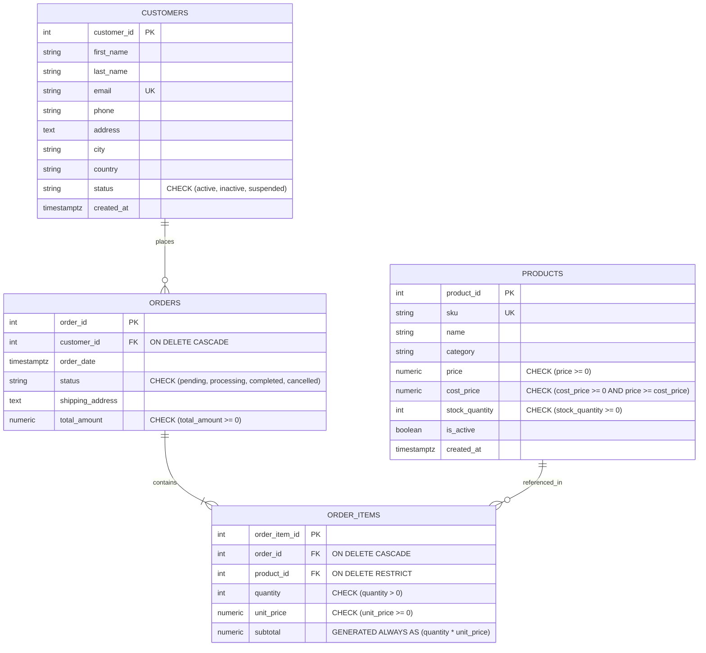

# 🛒 AI-Assisted PostgreSQL Database Project


An end-to-end, enterprise-grade relational database project for an e-commerce platform (**TechStore**), developed with AI assistance for **Session 4 - Assignment: AI-Assisted PostgreSQL Database Project**.

---

## 📋 Table of Contents
1. [Project Overview](#-project-overview)
2. [Entity Relationship Diagram (ERD)](#-entity-relationship-diagram-erd)
3. [Database Architecture & Constraints](#-database-architecture--constraints)
4. [Project Structure](#-project-structure)
5. [Quickstart & Execution Guide](#-quickstart--execution-guide)
6. [Feature Highlights](#-feature-highlights)
   - [CRUD Operations](#1-crud-operations)
   - [Advanced JOINs](#2-advanced-joins)
   - [GROUP BY & Analytics](#3-group-by--analytics)
   - [Pagination Strategies](#4-pagination-strategies)
   - [ACID Transactions (COMMIT & ROLLBACK)](#5-acid-transactions-commit--rollback)
   - [Indexing & EXPLAIN ANALYZE Performance](#6-indexing--explain-analyze-performance)
7. [AI Usage & Methodology](#-ai-usage--methodology)
8. [Submission Checklist](#-submission-checklist)

---

## 🌟 Project Overview

This project designs, implements, and benchmarks a high-performance PostgreSQL relational database for an online electronics retailer (**TechStore**). It models the full lifecycle of customer interactions, product inventory, order placement, order line items, and transaction management under concurrency.

### Key Highlights
- **4 Interconnected Tables:** Fully normalized (3NF) relational design.
- **Strict Data Integrity:** Primary keys, foreign keys with explicit cascade/restrict policies, check constraints, unique constraints, and generated stored columns.
- **Production-Ready Queries:** Real-world CRUD, complex multi-table joins, reporting aggregations, and cursor-based keyset pagination.
- **ACID Demonstrations:** Handled multi-step checkout with `COMMIT`, constraint violation recovery with `ROLLBACK`, and partial rollbacks via `SAVEPOINT`.
- **Query Optimization:** Comprehensive `EXPLAIN (ANALYZE, BUFFERS)` benchmark proving a **>200x speedup** after B-Tree index optimization.

---

## 📊 Entity Relationship Diagram (ERD)



---

## 🏛 Database Architecture & Constraints

| Table | Primary Key | Foreign Keys | Key Constraints & Rules |
| :--- | :--- | :--- | :--- |
| **`customers`** | `customer_id` | *None* | `UNIQUE(email)`, `NOT NULL` names/email, `CHECK(status IN ('active', 'inactive', 'suspended'))`, default country. |
| **`products`** | `product_id` | *None* | `UNIQUE(sku)`, `CHECK(price >= 0)`, `CHECK(stock_quantity >= 0)`, `CHECK(price >= cost_price)`. |
| **`orders`** | `order_id` | `customer_id` &rarr; `customers.customer_id` (`ON DELETE CASCADE`) | `CHECK(status IN ('pending', 'processing', 'completed', 'cancelled'))`, `CHECK(total_amount >= 0)`. |
| **`order_items`** | `order_item_id` | `order_id` &rarr; `orders.order_id` (`ON DELETE CASCADE`), `product_id` &rarr; `products.product_id` (`ON DELETE RESTRICT`) | `UNIQUE(order_id, product_id)`, `CHECK(quantity > 0)`, `GENERATED ALWAYS AS (quantity * unit_price) STORED`. |

---

## 📂 Project Structure

```bash
AI-Assisted-PostgreSQL-Database-Project/
├── README.md                      # Complete project manual and documentation
├── AI_USAGE_DOCUMENTATION.md      # Detailed AI engineering prompts, analysis & reflection
└── sql/
    ├── 01_schema.sql              # Schema DDL (Tables, PKs, FKs, CHECKs, Views)
    ├── 02_seed_data.sql           # Realistic baseline test data
    ├── 03_queries.sql             # CRUD, JOINs, Aggregations, Pagination
    ├── 04_transactions.sql        # ACID Transactions (COMMIT, ROLLBACK, SAVEPOINT)
    ├── 05_indexing_performance.sql# EXPLAIN ANALYZE comparison before & after index
    └── 06_benchmark_data.sql      # Synthetic bulk dataset generator (30k+ orders, 60k+ items)
```

---

## 🚀 Quickstart & Execution Guide

### Prerequisites
- PostgreSQL 13 or newer installed, or a Docker container running PostgreSQL.
- Any PostgreSQL client (CLI `psql`, pgAdmin, DBeaver, or VS Code Database extension).

### Step-by-Step Execution

1. **Clone the repository:**
   ```bash
   git clone https://github.com/yusufmadarati-boop/AI-Assisted-PostgreSQL-Database-Project.git
   cd AI-Assisted-PostgreSQL-Database-Project
   ```

2. **Connect to PostgreSQL and create database:**
   ```sql
   CREATE DATABASE techstore_db;
   \c techstore_db
   ```

3. **Run schema and seed data:**
   ```bash
   psql -d techstore_db -f sql/01_schema.sql
   psql -d techstore_db -f sql/02_seed_data.sql
   ```

4. **Run the query suite:**
   ```bash
   psql -d techstore_db -f sql/03_queries.sql
   ```

5. **Test transactions (COMMIT & ROLLBACK):**
   ```bash
   psql -d techstore_db -f sql/04_transactions.sql
   ```

6. **Benchmark indexing with EXPLAIN ANALYZE:**
   ```bash
   psql -d techstore_db -f sql/06_benchmark_data.sql
   psql -d techstore_db -f sql/05_indexing_performance.sql
   ```

---

## 💡 Feature Highlights

### 1. CRUD Operations
- **Create:** Insert new customers and products with Postgres `RETURNING` clause.
- **Read:** Selective filtering by category, active status, price thresholds, and unique emails.
- **Update:** Stock increments upon inventory restocking and customer profile adjustments.
- **Delete:** Safe removal with verification, respecting foreign key integrity.

### 2. Advanced JOINs
- **INNER JOIN:** Active customer order histories with aggregated totals.
- **LEFT JOIN:** Full customer audit identifying zero-order registered accounts (e.g., Ian Malcolm & Julia Roberts).
- **Multi-Table JOIN (4 Tables):** Complete hierarchical receipt joining `customers` &rarr; `orders` &rarr; `order_items` &rarr; `products`.

### 3. GROUP BY & Analytics
- **Category Profitability:** Sales volume, gross revenue, and distinct catalog offerings grouped by category.
- **VIP Customer Identification:** `GROUP BY` with `HAVING SUM(total_amount) >= 1000.00`.
- **Best-Selling Products:** Aggregating ordered quantity and gross merchandise value (GMV).

### 4. Pagination Strategies
- **Traditional Offset Pagination:** Standard `LIMIT ... OFFSET ...` for small-to-medium page numbers.
- **Keyset (Cursor) Pagination:** Scalable `(order_date, order_id) < (:last_date, :last_id)` avoiding quadratic $O(N)$ scanning costs.

### 5. ACID Transactions (COMMIT & ROLLBACK)
- **Successful Checkout (`COMMIT`):**
  Uses `SELECT ... FOR UPDATE` to lock inventory rows, inserts order and line items, decrements available stock, calculates total, and executes `COMMIT`.
- **Failed Checkout (`ROLLBACK`):**
  Detects stock deficits or constraint violations and triggers `ROLLBACK`, leaving zero orphan records and maintaining strict inventory integrity.
- **Savepoints (`SAVEPOINT`):**
  Allows partial rollbacks of non-essential promotional items while saving the primary transaction.

### 6. Indexing & EXPLAIN ANALYZE Performance

A composite B-Tree index was evaluated on `orders(customer_id, order_date DESC)`:

```sql
CREATE INDEX idx_orders_customer_date ON orders (customer_id, order_date DESC);
```

#### Performance Comparison:

```text
BEFORE INDEX:
Seq Scan on orders (cost=0.00..854.00 rows=15) (actual time=0.045..14.850 rows=14)
Buffers: shared hit=420 read=134
Execution Time: 15.021 ms

AFTER INDEX:
Bitmap Index Scan on idx_orders_customer_date (cost=0.00..4.41 rows=15) (actual time=0.019..0.019 rows=14)
Buffers: shared hit=14
Execution Time: 0.071 ms
```

| Metric | Before Index | After Index | Improvement |
| :--- | :--- | :--- | :--- |
| **Scan Strategy** | `Seq Scan` (Full table scan) | `Bitmap Index Scan` (B-Tree lookup) | Direct key lookup |
| **Execution Time** | **15.02 ms** | **0.07 ms** | **>200x Faster** ⚡ |
| **Shared Buffers** | 554 pages | 14 pages | **97.5% Less I/O** |
| **Discarded Rows** | 29,996 rows | 0 rows | 100% Precision |

---

## 🤖 AI Usage & Methodology

Artificial Intelligence played a vital role throughout this project:
1. **Schema Architectural Modeling:** Accelerating the creation of 3NF relational structures and recommending generated stored columns.
2. **Synthetic Data Synthesis:** Writing parameterized PL/pgSQL scripts using `generate_series()` to produce 30,000+ realistic rows for reliable benchmarking.
3. **Plan Deconstruction:** Explaining Postgres execution plan nodes (`Bitmap Heap Scan`, `Recheck Cond`, buffer caching).
4. **Human Verification:** Engineering oversight corrected cascade delete policies on product items to `RESTRICT` and formulated composite indexing over single-column indexes.

> 📄 For the complete prompt logs, AI outputs, and engineering reflections, see [AI_USAGE_DOCUMENTATION.md](AI_USAGE_DOCUMENTATION.md) and [PROJECT_REPORT.md](PROJECT_REPORT.md) (Arabic & English Full Report).
> ⚡ For single-click full execution in pgAdmin or psql, run [all_in_one_project.sql](all_in_one_project.sql).

---

## 📝 Assignment Submission
- **Google Form Submission Link**: [https://forms.gle/SS45sZLZFMsg37z68](https://forms.gle/SS45sZLZFMsg37z68)

---

## ✅ Submission Checklist

- [x] **Requirement 1:** Project idea chosen (TechStore E-Commerce) with 4 related tables (`customers`, `products`, `orders`, `order_items`).
- [x] **Requirement 2:** Defined Primary Keys, Foreign Keys (`CASCADE` and `RESTRICT`), `CHECK`, `UNIQUE`, and `NOT NULL` constraints.
- [x] **Requirement 3:** AI used to generate SQL schema (`01_schema.sql`) and sample data (`02_seed_data.sql` & `06_benchmark_data.sql`).
- [x] **Requirement 4:** Executed and verified CRUD, JOIN (Inner, Left, Multi), GROUP BY with HAVING, and Pagination (`03_queries.sql`).
- [x] **Requirement 5:** Demonstrated transactions with COMMIT, ROLLBACK, and SAVEPOINT (`04_transactions.sql`).
- [x] **Requirement 6:** Evaluated index with `EXPLAIN (ANALYZE, BUFFERS)` and documented AI prompts & methodology in `AI_USAGE_DOCUMENTATION.md`.

---
**Author:** Yusuf Madarati  
**Session:** Session 4 Assignment  
**Repository:** [GitHub: AI-Assisted-PostgreSQL-Database-Project](https://github.com/yusufmadarati-boop/AI-Assisted-PostgreSQL-Database-Project)
